# Asistencia Agropecuaria

**Sistema de escritorio para descargar checadas, calcular asistencias y generar reportes Excel.**

Aplicación local para Windows que conecta checadores ZKTeco y Hikvision, cruza los registros con horarios, personas y días no laborados, y produce reportes diarios, semanales o mensuales.

<p>
  
  
  
  
  
</p>

[Perfil de GitHub](https://github.com/JosueLuceroG) · [Reporte de ejemplo](demo/reporte-ejemplo.xlsx)

---

> [!NOTE]
> Esta es una edición pública de portafolio. Los checadores, personas, horarios, credenciales y reportes incluidos son ficticios. No se publican datos, rutas, infraestructura ni información de la empresa para la que nació el proyecto.

## El proyecto

Asistencia Agropecuaria nació como una herramienta operativa para una empresa agropecuaria: cada día había que conectar varios checadores, unir registros de entrada y salida, revisar retardos, faltas y horarios especiales, y entregar un Excel listo para nómina.

La versión 4.2 concentra ese flujo en una aplicación de escritorio. Todo se ejecuta de forma local: la configuración, la caché de checadas y los reportes viven en archivos JSON y Excel, sin backend ni servicios en la nube. La interfaz está construida con Tkinter y el ejecutable se empaqueta con PyInstaller.

<table>
  <tr>
    <td width="38%" align="center" valign="top">
      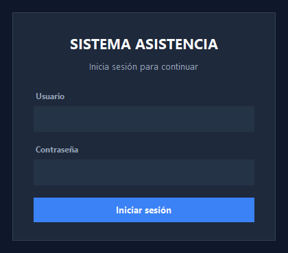
      <br />
      <sub>Acceso restringido por usuario y permisos.</sub>
    </td>
    <td width="62%" align="center" valign="top">
      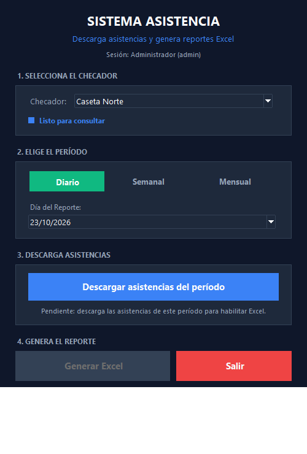
      <br />
      <sub>Panel principal con periodo, checador y estado de la descarga.</sub>
    </td>
  </tr>
</table>

## Lo que hace

- **Descarga asistencias** desde checadores ZKTeco por red y Hikvision mediante ISAPI.
- **Administra varios checadores** con IP, puerto, marca, personas asignadas y horario propio.
- **Calcula entrada, salida, retardos, faltas y horas trabajadas** a partir de las checadas.
- **Aplica horarios generales, especiales y por día**, además de tolerancias configurables.
- **Considera días no laborados** para no castigar faltas en festivos o mantenimientos.
- **Genera reportes diarios, semanales o mensuales** en Excel con formato, leyenda y resumen.
- **Conserva una caché local** para deduplicar registros y consultar la última sincronización.
- **Incluye historial de reportes y respaldos** con validación, restauración y rollback.
- **Gestiona usuarios y permisos** para separar tareas de administración y nómina.
- **Centraliza el estado de biometría** por persona y checador.
- **Se empaqueta como aplicación de Windows** sin consola visible.

## Capturas

### Configuración

<table>
  <tr>
    <td width="50%" align="center" valign="top">
      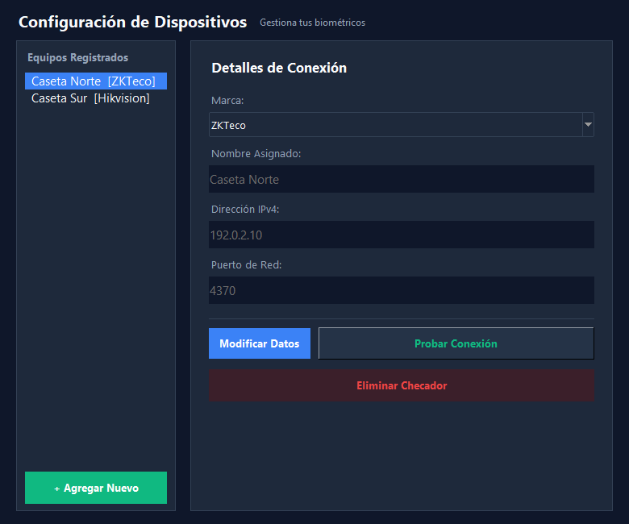
      <br />
      <sub>Checadores, direcciones y modo de conexión.</sub>
    </td>
    <td width="50%" align="center" valign="top">
      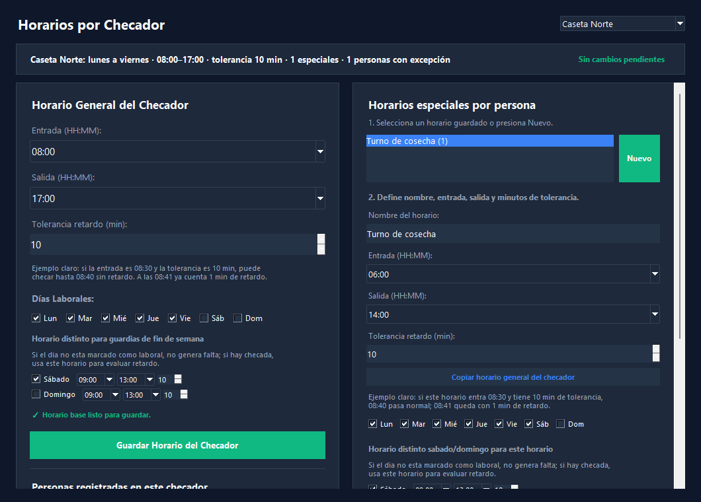
      <br />
      <sub>Horarios generales, por día y especiales.</sub>
    </td>
  </tr>
  <tr>
    <td width="50%" align="center" valign="top">
      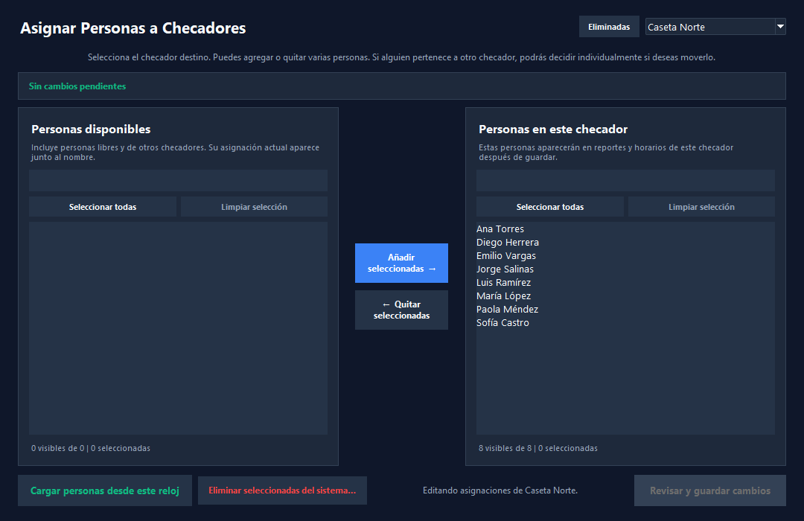
      <br />
      <sub>Asignación de personas a cada checador.</sub>
    </td>
    <td width="50%" align="center" valign="top">
      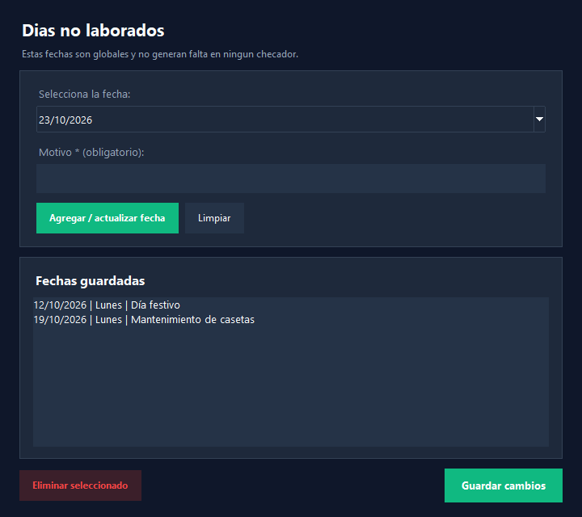
      <br />
      <sub>Festivos y excepciones del calendario.</sub>
    </td>
  </tr>
</table>

### Historial y control

<table>
  <tr>
    <td width="50%" align="center" valign="top">
      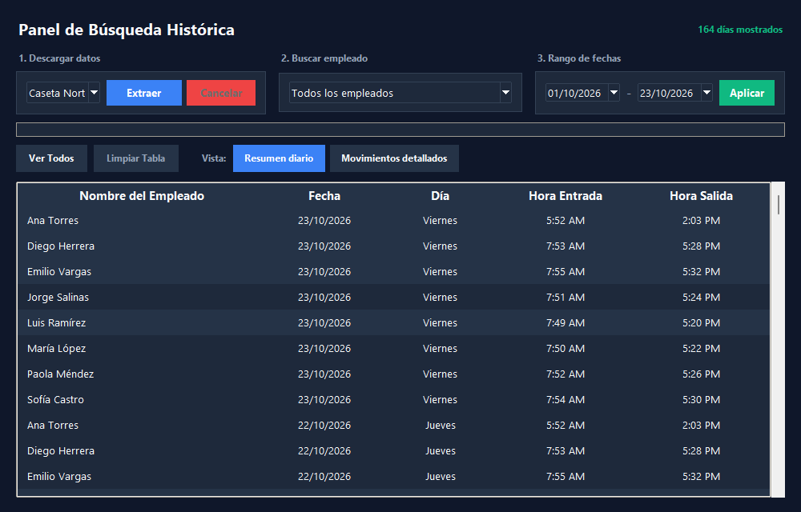
      <br />
      <sub>Consulta de registros procesados y resumen por persona.</sub>
    </td>
    <td width="50%" align="center" valign="top">
      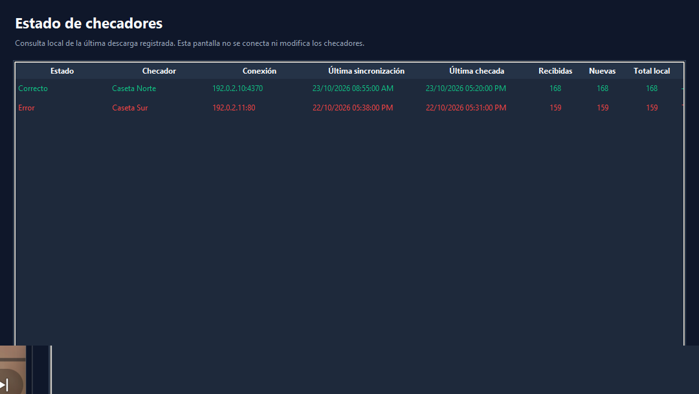
      <br />
      <sub>Última sincronización y errores por equipo.</sub>
    </td>
  </tr>
  <tr>
    <td width="50%" align="center" valign="top">
      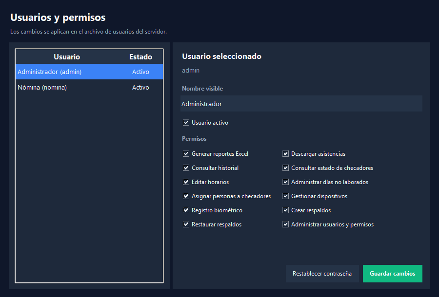
      <br />
      <sub>Usuarios, roles y permisos por tarea.</sub>
    </td>
    <td width="50%" align="center" valign="top">
      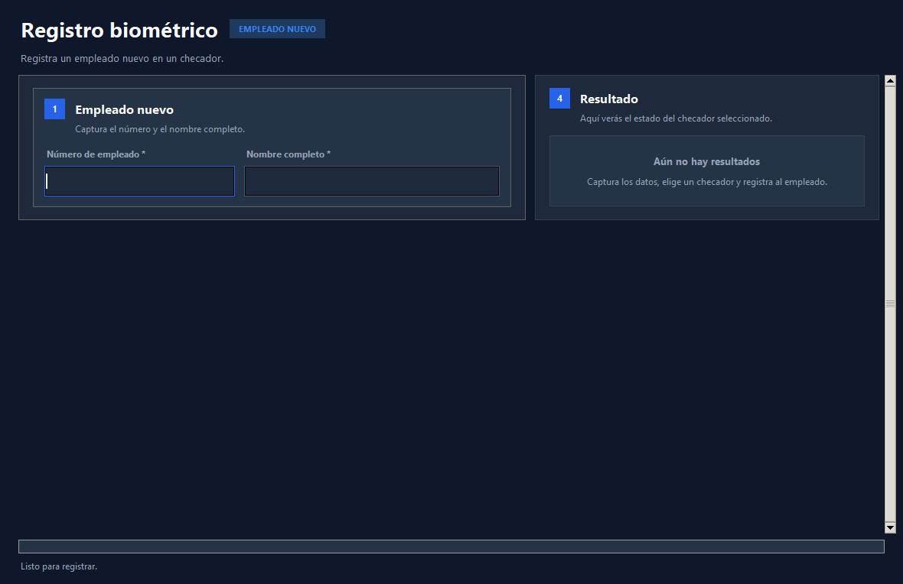
      <br />
      <sub>Seguimiento de huella, rostro y acceso por persona.</sub>
    </td>
  </tr>
</table>

### Reporte Excel

<div align="center">
  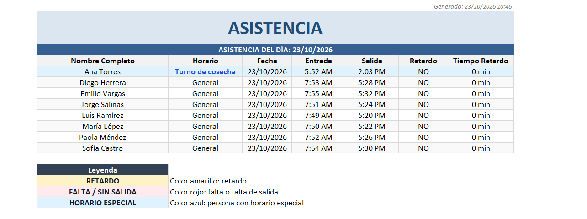
  <br />
  <sub>Reporte diario con horario aplicado, entradas, salidas, retardos y leyenda.</sub>
</div>

<sub>Capturas tomadas de la demo en Windows a 1536 × 864 px, con la caché ficticia de demostración cargada. Todos los nombres y dispositivos son ficticios.</sub>

## Demo incluida

La carpeta `demo/` contiene una configuración completa con ocho personas, dos checadores, horarios, días no laborados, usuarios y un reporte de ejemplo.

### Credenciales

| Usuario | Contraseña | Perfil |
| --- | --- | --- |
| `admin` | `Demo123!` | Administrador |
| `nomina` | `Nomina123!` | Nómina |

> Estas credenciales son sólo para la demo. No las reutilices en una instalación con datos reales.

> Los checadores del demo usan direcciones reservadas (`192.0.2.10` y `192.0.2.11`) que no existen en una red real. La descarga de asistencias fallará; el resto de la interfaz, la configuración, el historial y el reporte de ejemplo se pueden revisar sin hardware.

### Ejecutar la demo

Requisitos: Windows 10 u 11, Python 3.11 o superior y Tkinter (incluido en el instalador oficial de Python para Windows).

```powershell
git clone https://github.com/JosueLuceroG/asistencia-agropecuaria.git
cd asistencia-agropecuaria
python -m venv .venv
.\.venv\Scripts\Activate.ps1
python -m pip install -r requirements.txt
.\run_demo.ps1
```

También puedes hacer doble clic en `run_demo.cmd`. Ambos lanzadores configuran `ASISTENCIA_CONFIG_DIR` hacia `demo/`, para no mezclar la demostración con datos reales.

Si PowerShell bloquea la activación del entorno virtual:

```powershell
powershell -ExecutionPolicy Bypass -File .\run_demo.ps1
```

### Ejecutar con datos propios

Crea una carpeta dedicada para la configuración y define las variables antes de iniciar:

```powershell
$env:ASISTENCIA_CONFIG_DIR = "C:\AsistenciaDatos"
$env:ASISTENCIA_EXCEL_PASSWORD = "una-clave-local"
python "main v4.py"
```

En el primer inicio se crea la cuenta `admin` sin contraseña. La aplicación pedirá configurarla antes de entrar. Después puedes registrar checadores, personas, horarios y usuarios desde la interfaz.

## Datos y privacidad

- La aplicación funciona sin conexión a internet; sólo se conecta a los checadores de la red local.
- La configuración, la caché de asistencias y el historial se guardan en `ASISTENCIA_CONFIG_DIR`.
- Las preferencias visuales se guardan por usuario en `%APPDATA%\AsistenciaAgropecuaria`.
- Las contraseñas se almacenan como hashes PBKDF2-SHA256, no en texto plano.
- Los reportes pueden protegerse con `ASISTENCIA_EXCEL_PASSWORD`.
- La carpeta `demo/` sólo contiene información ficticia. No la uses para datos reales.
- `.gitignore` excluye configuraciones operativas, reportes, respaldos, cachés y entornos virtuales.

Si la aplicación se usa con datos reales, los respaldos y la carpeta de configuración deben restringirse a las personas autorizadas.

## Stack técnico

| Capa | Tecnología |
| --- | --- |
| Lenguaje | Python 3.13 (probado con 3.13.1) |
| Interfaz | Tkinter y ttk |
| Datos | pandas |
| Excel | openpyxl |
| ZKTeco | pyzk |
| Hikvision | ISAPI sobre HTTP/XML |
| Fechas | tkcalendar y `zoneinfo` |
| Imágenes | Pillow y OpenCV |
| Empaquetado | PyInstaller (`onedir`) |
| Pruebas | `unittest` |

## Estructura del proyecto

```text
asistencia-agropecuaria/
├── main v4.py                  # Punto de entrada y flujo principal
├── config_manager.py           # Normalización y persistencia de configuración
├── attendance_calculator.py    # Cálculo de asistencia y horarios
├── excel_exporter.py           # Generación de reportes Excel
├── theme.py                    # Paleta y estilos de la interfaz
├── config/                     # Rutas y preferencias
├── device_connectors/          # Conector Hikvision ISAPI
├── models/                     # Modelos de historial de reportes
├── services/                   # Autenticación, caché, respaldos, biometría
├── ui/                         # Ventanas y componentes de Tkinter
├── tests/                      # Suite de pruebas unitarias
├── demo/                       # Configuración y reporte de demostración
├── screenshots/                # Capturas de la edición pública
├── run_demo.cmd                # Lanzador de la demo para Windows
├── run_demo.ps1                # Lanzador de la demo para PowerShell
├── Asistencia_Agropecuaria_v4.spec
└── requirements.txt
```

## Pruebas

```powershell
python -m unittest discover -s tests -v
```

La suite no inicia la ventana principal, no usa checadores reales y no realiza conexiones de red. Consulta [TESTING.md](TESTING.md) para el detalle y para el diagnóstico manual opcional de Hikvision.

## Generar el ejecutable

Instala PyInstaller en el entorno virtual y usa la especificación incluida:

```powershell
python -m pip install pyinstaller
python -m PyInstaller --clean --noconfirm "Asistencia_Agropecuaria_v4.spec"
```

El resultado es una carpeta autocontenida:

```text
dist\Asistencia_Agropecuaria_v4\Asistencia_Agropecuaria_v4.exe
```

La carpeta `build/` es temporal y puede eliminarse después de validar el ejecutable.

## Alcance

- Aplicación de escritorio para Windows; no hay versión web ni móvil.
- Una sola sesión activa por carpeta de datos para proteger los archivos JSON.
- La descarga de asistencias requiere un checador compatible y accesible en la red local.
- Los conectores incluidos son ZKTeco (pyzk) e Hikvision (ISAPI); otras marcas requerirían un adaptador.
- El repositorio no incluye datos reales, infraestructura interna, credenciales de producción ni historial de la empresa.

## Créditos

Diseño y desarrollo: **Josué Lucero**.

Proyecto de portafolio. Todos los derechos reservados. ZKTeco, Hikvision, Microsoft Excel y Windows son marcas de sus respectivos titulares; este proyecto no está afiliado a ellos.

---

<div align="center">
  <sub>Hecho en México · <a href="https://github.com/JosueLuceroG">github.com/JosueLuceroG</a></sub>
</div>
